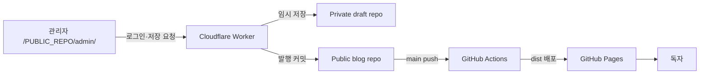
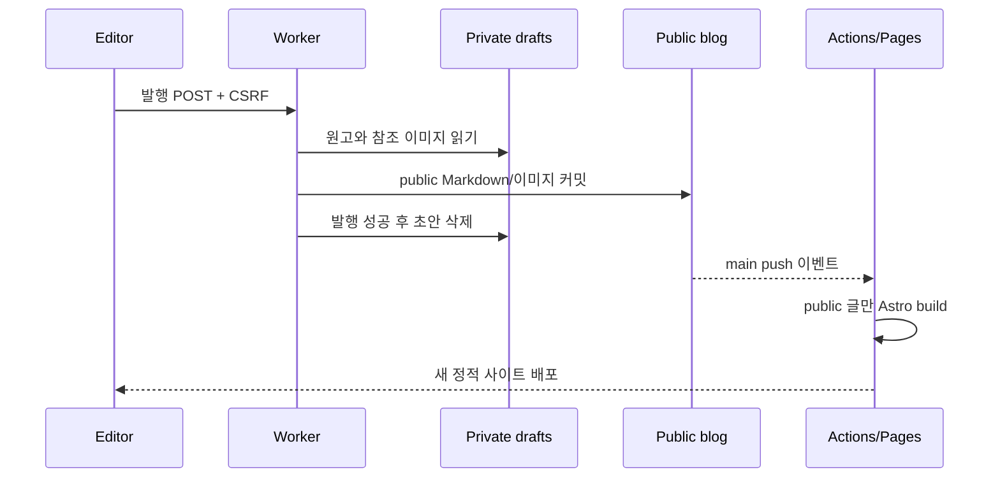

# 실서비스 생성·연결·배포·운영 가이드

이 문서는 이 프로젝트를 자신의 GitHub·Cloudflare 계정에 배포하려는 사용자를 위한 공개 가이드입니다. 특정 사용자의 로컬 경로나 계정명을 전제로 하지 않으며, 예시는 공개 레포 이름이 `blog`인 **프로젝트 Pages** 기준입니다.

명령을 시작하기 전에 프로젝트 루트에서 자신의 값으로 변수를 설정합니다. 새 터미널을 열었다면 이 설정도 다시 실행합니다. 별도 설명이 없는 명령 블록은 서로 독립적이며 프로젝트 루트에서 시작한다고 가정합니다.

```bash
GITHUB_OWNER="your-github-id"
PUBLIC_REPO="blog"
DRAFT_REPO="blog-drafts"
WORKER_NAME="blog-editor-api"
```

문서의 `<github-id>`, `<public-repo>`, `<draft-repo>`, `<worker-name>`, `<workers-subdomain>` 표기도 위 변수나 각 서비스에서 발급받은 실제 값으로 바꿔야 합니다. `blog`와 `blog-drafts`는 예시 이름이므로 원하는 이름을 사용할 수 있지만, 이후 모든 설정에서 같은 이름을 사용해야 합니다.

## 1. 최종적으로 무엇을 만드는가

GitHub 레포는 두 개, 배포 대상은 두 개입니다.

| 종류 | 예시 이름 | 공개 여부 | 저장하는 것 | 배포 여부 |
| --- | --- | --- | --- | --- |
| 공개 블로그 레포 | `<github-id>/<public-repo>` | Public | 현재 프로젝트 전체, 공개 글, Worker 소스 | `main` → GitHub Pages |
| 비공개 원고 레포 | `<github-id>/<draft-repo>` | Private | 초안과 발행 전 이미지 | 배포하지 않음 |
| Pages 배포 | `https://<github-id>.github.io/<public-repo>/` | Public | Astro가 만든 정적 HTML | GitHub Actions가 자동 배포 |
| API 배포 | `https://<worker-name>.<workers-subdomain>.workers.dev` | Public endpoint | OAuth와 GitHub 저장 API | `editor-api`에서 수동 배포 |

OAuth App과 Cloudflare Worker는 GitHub 레포가 아닙니다. 외부 서비스에 만드는 설정 및 실행 인스턴스입니다.



### 왜 세 레포로 나누지 않는가

Worker **코드**는 공개되어도 보안 경계가 무너지지 않습니다. `GITHUB_CLIENT_SECRET`과 `SESSION_SECRET`은 Cloudflare secret으로만 보관하고 Git에 넣지 않기 때문입니다. 지금 규모에서는 Worker 소스를 공개 블로그 레포의 `editor-api/`에 두면 코드 변경을 한 커밋에서 추적할 수 있습니다.

반면 초안은 원문 자체가 비밀입니다. `status: draft`라 해도 Public 레포에 커밋하면 빌드에서 숨길 뿐 Git 히스토리와 raw URL에는 남습니다. 그래서 초안 레포만은 반드시 Private으로 분리합니다.

```text
공개 여부를 결정하는 진짜 경계

Public 레포의 draft  ── 빌드에는 안 나옴 / 원본과 Git 기록은 공개됨  ✗
Private 레포의 draft ── 저장소 접근 권한이 없으면 원본을 못 봄       ✓
```

팀이 커져 Worker의 배포 권한과 변경 주기를 별도로 관리해야 할 때만 `blog-editor-api`를 세 번째 레포로 분리하는 편이 낫습니다. 현재 코드에는 기능적 이득 없이 운영 대상만 늘어납니다.

## 2. 먼저 확정할 값

아래 표를 실제 값으로 채운 뒤 시작하면 경로 오타를 크게 줄일 수 있습니다.

| 이름 | 프로젝트 Pages 예시 | 주의점 |
| --- | --- | --- |
| `GITHUB_OWNER` | `your-github-id` | 대소문자보다 실제 로그인명을 그대로 쓰는 편이 명확함 |
| `PUBLIC_REPO_NAME` | `blog` | 현재 프로젝트가 올라갈 Public 레포 |
| `PRIVATE_REPO_NAME` | `blog-drafts` | 반드시 Private |
| `EDITOR_ORIGIN` | `https://<github-id>.github.io` | **경로와 마지막 `/`를 넣지 않음** |
| `EDITOR_RETURN_URL` | `https://<github-id>.github.io/<public-repo>/admin/` | 프로젝트 경로와 마지막 `/`까지 포함 |
| `PUBLIC_EDITOR_API_URL` | 첫 Worker 배포 후 확정 | 마지막 `/`를 넣지 않음 |

브라우저의 `Origin` 값은 `scheme + host + port`만 포함합니다. 그래서 프로젝트 Pages여도 `EDITOR_ORIGIN`에는 repository 경로가 들어가면 안 됩니다. 반대로 로그인 후 돌아갈 `EDITOR_RETURN_URL`은 완전한 관리자 페이지 URL이어야 합니다.

## 3. 공개 블로그 레포 만들고 연결하기

### GitHub 웹에서 만들기

1. GitHub의 **New repository**를 엽니다.
2. Repository name을 `$PUBLIC_REPO`에 정한 이름, Visibility를 **Public**으로 정합니다.
3. **Add a README**, `.gitignore`, License는 모두 선택하지 않고 빈 레포로 만듭니다.

이미 내려받은 프로젝트에는 파일과 Git 이력이 있을 수 있습니다. 원격 레포까지 README로 초기화하면 서로 다른 첫 커밋이 생길 수 있으므로 새 원격은 비워 둡니다.

### 현재 Git 상태부터 판별하기

프로젝트 루트에서 다음 세 명령을 먼저 실행합니다.

```bash
git status
git branch --show-current
git remote -v
```

결과에 따라 다음 중 하나만 선택합니다.

| 현재 상태 | 해야 할 일 |
| --- | --- |
| `origin`이 없음 | 아래의 `remote add` 실행 |
| `origin`이 이미 자신의 새 Public 레포 | remote 추가 없이 push |
| `origin`이 이 프로젝트의 원본 레포 | 기존 origin을 `upstream`으로 바꾸고 자신의 origin 추가 |

배포 workflow는 `main` push를 감시합니다. 새 프로젝트의 현재 브랜치가 다른 이름이고 기본 브랜치를 `main`으로 사용할 계획이라면 remote 연결 전에 `git branch -M main`으로 맞춥니다. 기존 협업 저장소의 브랜치 이름은 임의로 바꾸지 말고 workflow의 대상 브랜치와 함께 검토합니다.

원본 프로젝트를 clone해 `origin`이 이미 사용 중이라면 다음처럼 보존합니다.

```bash
git remote rename origin upstream
git remote add origin "git@github.com:${GITHUB_OWNER}/${PUBLIC_REPO}.git"
```

`origin`이 없다면 SSH 또는 HTTPS 중 자신의 인증 방식에 맞는 주소 하나만 추가합니다.

```bash
# SSH
git remote add origin "git@github.com:${GITHUB_OWNER}/${PUBLIC_REPO}.git"

# 또는 HTTPS
git remote add origin "https://github.com/${GITHUB_OWNER}/${PUBLIC_REPO}.git"
```

아직 첫 커밋이 없는 로컬 소스라면 secret 파일이 stage되지 않는지 확인한 뒤 커밋합니다. 이미 커밋이 있다면 이 단계는 건너뜁니다.

```bash
git status --short
git add .
git diff --cached --name-only
git commit -m "chore: initialize blog"
```

`git diff --cached --name-only`에 `.env`, `.dev.vars`, token이나 secret 파일이 보이면 commit하지 말고 `.gitignore`부터 고칩니다. 준비가 끝나면 자신의 원격으로 push합니다.

```bash
git push -u origin main
```

GitHub CLI가 로그인된 환경이고 `origin`이 아직 없다면, 웹에서 빈 레포를 만드는 대신 다음 명령으로 생성·연결·push할 수 있습니다. 첫 커밋은 이 명령 전에 만들어져 있어야 합니다.

```bash
gh repo create "${GITHUB_OWNER}/${PUBLIC_REPO}" --public --source=. --remote=origin --push
```

확인 기준은 다음과 같습니다.

- GitHub의 Public 레포에서 `package.json`, `src/`, `editor-api/`, `.github/workflows/deploy.yml`이 보인다.
- `node_modules/`, `dist/`, `.env`, `.dev.vars`는 보이지 않는다.
- 기본 브랜치는 `main`이다.

## 4. 비공개 원고 레포 만들기

1. GitHub의 **New repository**를 엽니다.
2. Repository name을 `$DRAFT_REPO`에 정한 이름, Visibility를 **Private**으로 정합니다.
3. 이번에는 **Add a README**를 선택해 첫 커밋이 있는 레포로 만듭니다.

GitHub Contents API는 레포의 기본 브랜치에 파일을 커밋합니다. 완전히 빈 레포는 기본 브랜치가 없어 첫 API 저장이 실패할 수 있으므로 Private 레포는 초기화합니다.

선택 사항이지만 다음 빈 폴더 표식을 한 번 커밋해 구조를 눈에 보이게 만드는 것을 권장합니다.

```text
$DRAFT_REPO/
├── README.md
├── draft/
│   └── .gitkeep
└── assets/
    └── images/
        └── .gitkeep
```

명령으로 만들려면 작업 프로젝트 **밖의 임시 디렉터리**에서 실행합니다.

```bash
DRAFT_SETUP_DIR="$(mktemp -d)"
git clone "git@github.com:${GITHUB_OWNER}/${DRAFT_REPO}.git" "$DRAFT_SETUP_DIR"
cd "$DRAFT_SETUP_DIR"
mkdir -p draft assets/images
touch draft/.gitkeep assets/images/.gitkeep
git add draft/.gitkeep assets/images/.gitkeep
git commit -m "chore: initialize draft storage"
git push
```

이 레포에는 Pages, Actions 배포, 공개 collaborator가 필요하지 않습니다. 작성에 사용하는 GitHub 계정만 write 권한을 가지면 됩니다.

## 5. GitHub Pages를 먼저 배포하기

공개 레포에서 **Settings → Pages → Build and deployment → Source → GitHub Actions**를 선택합니다. 이 프로젝트의 `.github/workflows/deploy.yml`이 이미 다음 작업을 합니다.

```text
main push
  → npm ci
  → astro check
  → astro build
  → dist 업로드
  → GitHub Pages 배포
```

처음 push가 Pages 활성화보다 먼저 실행되어 실패했다면 **Actions → Deploy GitHub Pages → Re-run jobs**로 다시 실행합니다. 성공 후 주소는 보통 다음과 같습니다.

```text
https://<github-id>.github.io/<public-repo>/
https://<github-id>.github.io/<public-repo>/admin/
```

이 시점의 관리자 화면은 정상적으로 **로컬 편집 모드**라고 표시됩니다. 아직 `PUBLIC_EDITOR_API_URL`을 주입하지 않았기 때문이며 오류가 아닙니다.

워크플로는 `actions/configure-pages`가 돌려준 `origin`과 `base_path`를 Astro에 전달합니다. 따라서 프로젝트 Pages의 repository 경로를 소스에 하드코딩하지 않아도 CSS, 글 링크, sitemap 경로가 맞습니다.

## 6. Cloudflare Worker의 공개 설정 입력하기

프로젝트 루트로 돌아온 뒤 `editor-api/wrangler.jsonc`의 `name`과 `vars`를 실제 값으로 바꿉니다.

```jsonc
{
  "$schema": "node_modules/wrangler/config-schema.json",
  "name": "blog-editor-api",
  "main": "src/index.js",
  "compatibility_date": "2026-08-20",
  "vars": {
    "ALLOWED_GITHUB_LOGIN": "your-github-id",
    "PUBLIC_REPO_OWNER": "your-github-id",
    "PUBLIC_REPO_NAME": "blog",
    "PRIVATE_REPO_OWNER": "your-github-id",
    "PRIVATE_REPO_NAME": "blog-drafts",
    "EDITOR_ORIGIN": "https://your-github-id.github.io",
    "EDITOR_RETURN_URL": "https://your-github-id.github.io/blog/admin/"
  }
}
```

이 값은 주소와 레포 이름이므로 secret이 아닙니다. 반면 다음 세 값은 이 파일에 절대 쓰지 않습니다.

```text
GITHUB_CLIENT_ID
GITHUB_CLIENT_SECRET
SESSION_SECRET
```

먼저 Worker를 한 번 배포해 URL을 확보합니다. secret이 아직 없어도 배포는 가능하고, API 요청만 `Missing environment`로 실패합니다.

```bash
cd editor-api
npm ci
npm run check
npm run deploy
```

처음 실행하면 Cloudflare 로그인과 `workers.dev` 서브도메인 생성을 요청할 수 있습니다. 출력된 URL을 기록합니다.

```text
https://<worker-name>.<workers-subdomain>.workers.dev
```

## 7. GitHub OAuth App 만들기

GitHub에서 **Settings → Developer settings → OAuth Apps → New OAuth App**으로 이동해 다음처럼 입력합니다.

| 필드 | 값 |
| --- | --- |
| Application name | `My Blog Editor` |
| Homepage URL | `https://<github-id>.github.io/<public-repo>/admin/` |
| Authorization callback URL | `https://<worker-name>.<workers-subdomain>.workers.dev/auth/callback` |

Callback URL은 Worker URL의 뒤에 `/auth/callback`을 붙인 **정확한 주소**여야 합니다. 이 프로젝트에는 wildcard가 필요하지 않으므로 wildcard matching은 끕니다. 만료형 access token은 켜 두어도 됩니다. 에디터 세션도 8시간이며 만료 후 다시 로그인하는 구조입니다.

OAuth App을 만든 뒤 Client ID와 새 Client secret을 복사합니다. secret은 생성 직후 안전한 암호 관리자에 보관합니다.

### Worker secret 등록

`editor-api` 폴더에서 각각 실행하고 프롬프트에 값을 붙여 넣습니다.

```bash
npx wrangler secret put GITHUB_CLIENT_ID
npx wrangler secret put GITHUB_CLIENT_SECRET
npx wrangler secret put SESSION_SECRET
```

`SESSION_SECRET`에는 직접 만든 짧은 암호가 아니라 다음처럼 생성한 충분히 긴 무작위 값을 사용합니다.

```bash
openssl rand -base64 48
```

`wrangler secret put`은 secret 값을 터미널 명령 기록이나 Git 파일에 남기지 않고 Cloudflare에 등록합니다. 등록된 **이름만** 확인할 수 있습니다.

```bash
npx wrangler secret list
```

세 이름이 모두 보이면 Worker 배포 상태를 다시 확인합니다.

```bash
npm run deploy
```

## 8. Pages와 Worker 연결하기

Public 레포에서 **Settings → Secrets and variables → Actions → Variables → New repository variable**을 선택합니다.

```text
Name:  PUBLIC_EDITOR_API_URL
Value: https://<worker-name>.<workers-subdomain>.workers.dev
```

이 URL은 공개 endpoint이므로 Actions **Secret**이 아니라 **Variable**이 맞습니다. 마지막 `/`는 넣지 않습니다. 소스가 `${apiUrl}/api/...` 형태로 경로를 붙이기 때문입니다.

CLI로 설정할 수도 있습니다.

```bash
WORKER_URL="https://your-worker.your-subdomain.workers.dev"
gh variable set PUBLIC_EDITOR_API_URL \
  --body "$WORKER_URL" \
  --repo "${GITHUB_OWNER}/${PUBLIC_REPO}"
gh workflow run deploy.yml --repo "${GITHUB_OWNER}/${PUBLIC_REPO}"
gh run watch --repo "${GITHUB_OWNER}/${PUBLIC_REPO}"
```

Actions variable은 실행 중인 Astro 빌드에 주입되어 정적 JavaScript에 API 주소를 넣습니다. 변수를 저장하는 것만으로 이미 배포된 HTML은 바뀌지 않으므로 `workflow_dispatch` 재실행이 필요합니다.

## 9. 최초 종단 간 검증

아래 순서대로 확인하면 어느 연결이 잘못됐는지 빠르게 좁힐 수 있습니다.

### 9.1 로그인

1. `https://<github-id>.github.io/<public-repo>/admin/`을 새로 엽니다.
2. `GitHub 연결 상태를 확인하는 중` 또는 로그인 링크가 보이는지 확인합니다.
3. GitHub 로그인 후 같은 관리자 URL로 돌아오는지 확인합니다.
4. 연결된 계정이 `ALLOWED_GITHUB_LOGIN`과 같은지 확인합니다.

```text
브라우저 → /auth/login → GitHub 동의 화면
       ← /auth/callback ← authorization code
       ← 암호화된 HttpOnly 세션 쿠키 + 관리자 URL 이동
```

### 9.2 임시 저장

1. 테스트 글을 작성하고 **임시 저장**을 누릅니다.
2. Private 레포의 `draft/{slug}.md`에 커밋이 생겼는지 확인합니다.
3. Public 레포와 Pages에는 글이 생기지 않았는지 확인합니다.

여기까지 성공하면 OAuth, 세션, CORS, Private 레포 쓰기가 모두 연결된 것입니다.

### 9.3 발행

1. 같은 테스트 글을 **발행**합니다.
2. Public 레포의 `src/content/posts/{slug}.md` 커밋이 생겼는지 확인합니다.
3. Private 레포의 `draft/{slug}.md`가 정리됐는지 확인합니다.
4. Public 레포의 새 커밋이 `Deploy GitHub Pages` Action을 시작했는지 확인합니다.
5. Action 성공 후 `/<public-repo>/posts/{slug}/`에서 글을 확인합니다.



## 10. 평소 운영 방식

### 글 운영

| 작업 | 실제로 바뀌는 곳 | 자동으로 일어나는 일 |
| --- | --- | --- |
| 새 글 임시 저장 | Private `draft/{slug}.md` | Pages는 그대로 유지 |
| 새 글 발행 | Public `src/content/posts/{slug}.md` | `main` push로 Pages 재배포 |
| 공개 글 수정 초안 | Private draft | 현재 공개본은 계속 노출 |
| 수정본 발행 | Public 글 갱신, Private draft 정리 | Pages 재배포 |
| 공개 글 삭제 | Public 글 파일 삭제 | 다음 배포부터 노출 중단 |

공개 글 삭제는 현재 사이트에서 내리는 기능이지 비밀 복구가 아닙니다. Public Git 히스토리, 검색 엔진, RSS 리더, 외부 캐시에 이미 복사된 내용은 회수할 수 없습니다.

### 코드 배포

| 변경 위치 | 배포 명령/트리거 | 중요한 차이 |
| --- | --- | --- |
| 루트 Astro 코드 | `main`에 push | GitHub Pages 자동 배포 |
| 에디터 화면 | `main`에 push | 정적 `/admin/` 자동 배포 |
| `editor-api/` Worker 코드 | `cd editor-api && npm run deploy` | **Git push만으로 Worker는 바뀌지 않음** |
| Private draft 레포 | 없음 | 저장소 역할만 수행 |

Worker 소스 변경은 먼저 Git에 커밋해 이력을 남기고, 같은 커밋의 `editor-api`를 배포합니다. 현재는 Worker CI가 없으므로 코드가 Git에 있는 버전과 실제 Worker 버전이 달라지지 않게 배포 직후 확인해야 합니다.

### 관찰과 장애 확인

GitHub Pages 상태:

```bash
gh run list --workflow deploy.yml --repo "${GITHUB_OWNER}/${PUBLIC_REPO}"
gh run watch --repo "${GITHUB_OWNER}/${PUBLIC_REPO}"
```

Worker 실시간 요청/예외:

```bash
cd editor-api
npx wrangler tail --format pretty
```

`wrangler tail`에는 요청 경로가 보일 수 있으므로 화면 공유나 로그 저장 시 개인정보를 확인합니다. 이 Worker는 의도적으로 OAuth token이나 secret을 `console.log`하지 않습니다.

### 안전한 롤백

공개 사이트나 글은 이력을 지우는 reset보다 `git revert`로 되돌립니다. 새 revert 커밋이 다시 Pages 배포를 시작하므로 무엇을 되돌렸는지 기록이 남습니다.

```bash
git revert <problem-commit-sha>
git push origin main
```

Worker는 최근 배포를 확인한 뒤 직전 버전으로 롤백할 수 있습니다.

```bash
cd editor-api
npx wrangler deployments list
npx wrangler rollback
```

Worker rollback은 즉시 활성 트래픽을 이전 버전으로 바꾸지만 로컬 파일과 Git 브랜치를 되돌리지는 않습니다. 장애가 끝난 뒤 소스에도 후속 수정 또는 revert를 남겨 실제 배포와 Git을 다시 일치시킵니다.

### secret 교체

- `GITHUB_CLIENT_SECRET`: GitHub OAuth App에서 새 secret 생성 → `wrangler secret put GITHUB_CLIENT_SECRET` → 기존 secret 폐기
- `SESSION_SECRET`: `wrangler secret put SESSION_SECRET`; 기존 로그인 쿠키가 모두 무효화되므로 다시 로그인해야 함
- OAuth 연결 전체 폐기: GitHub **Settings → Applications → Authorized OAuth Apps**에서 권한 취소

`wrangler.jsonc`의 공개 변수와 Cloudflare Dashboard 값을 양쪽에서 따로 고치지 않습니다. 설정 파일을 source of truth로 삼고 `npm run deploy`로 반영해야 다음 배포가 예전 값으로 되돌아가지 않습니다.

## 11. 자주 실패하는 이유

| 증상 | 원인 | 확인 및 해결 |
| --- | --- | --- |
| 관리자에 `로컬 편집 모드` 표시 | Pages 빌드 때 API URL이 없었음 | Actions Variable 설정 후 workflow 재실행 |
| OAuth 뒤 `Invalid OAuth state` | callback host 불일치, state 쿠키 소실 | OAuth callback URL과 현재 Worker URL을 정확히 일치시키고 쿠키 차단 확인 |
| API `401 GitHub login required` | 세션 만료 또는 cross-site 쿠키 차단 | 다시 로그인; 브라우저 정책 확인; 운영 도메인 구성 검토 |
| API `Origin not allowed` | `EDITOR_ORIGIN`에 프로젝트 경로를 넣었거나 도메인이 다름 | `https://<github-id>.github.io`처럼 origin만 지정 후 Worker 재배포 |
| GitHub API `403` | 다른 계정 로그인, `repo` scope 미승인, 조직 SSO/권한 문제 | 허용 계정과 두 레포 write 권한, OAuth 승인 상태 확인 |
| GitHub API `404` | owner/name 오타, Private 레포가 비어 있음 | `wrangler.jsonc` 값과 Private 레포 첫 커밋 확인 |
| 저장/삭제 `409` | 불러온 뒤 다른 곳에서 파일 변경, slug 중복 | 에디터에서 목록과 글을 다시 불러온 뒤 재시도 |
| 발행 커밋은 있는데 사이트가 그대로 | Actions 빌드 실패 또는 진행 중 | Public 레포 Actions 로그에서 schema/build 오류 확인 |
| CSS·링크가 repository 경로 없이 404 | `BASE_PATH`가 잘못된 수동 빌드 | Actions의 `configure-pages` 결과 사용; 로컬 `.env`는 `/<public-repo>` 지정 |
| Worker 코드를 push했는데 API가 그대로 | Worker는 자동 배포 대상이 아님 | `editor-api`에서 `npm run deploy` 실행 |
| branch protection 뒤 발행이 403/409 | Contents API의 `main` 직접 커밋을 규칙이 막음 | 작성 계정의 직접 커밋 허용 또는 API를 PR 방식으로 개조 |

현재 Worker는 GitHub OAuth의 `repo` scope를 사용합니다. Private 레포 쓰기에 필요하지만 이 scope는 로그인한 사용자가 접근 가능한 Public/Private 저장소 전반에 넓은 권한을 줍니다. `ALLOWED_GITHUB_LOGIN`은 다른 사용자의 진입을 막지만 token의 레포 범위를 두 레포로 줄이지는 않습니다. 보안 민감도가 높다면 다음 중 하나를 선택합니다.

1. 작성 전용 GitHub 계정을 만들고 이 두 레포에만 write 권한을 부여합니다.
2. 장기적으로 OAuth App 대신 repository별 `Contents: write` 권한을 가진 GitHub App으로 API를 교체합니다.

현재 코드는 OAuth App 계약으로 구현되어 있으므로 GitHub App은 설정만 바꿔 끼울 수 없고 인증 코드를 함께 수정해야 합니다.

## 12. 커스텀 도메인으로 옮길 때

예를 들어 Pages가 `https://blog.example.com`, Worker가 `https://editor-api.example.com`이 되면 네 값을 함께 바꿉니다.

| 위치 | 값 |
| --- | --- |
| Worker `EDITOR_ORIGIN` | `https://blog.example.com` |
| Worker `EDITOR_RETURN_URL` | `https://blog.example.com/admin/` |
| GitHub OAuth callback | `https://editor-api.example.com/auth/callback` 추가 |
| GitHub Actions `PUBLIC_EDITOR_API_URL` | `https://editor-api.example.com` |

순서는 **새 Worker 도메인 연결 → OAuth callback 추가 → Worker 공개 변수 배포 → Actions 변수 변경 및 Pages 재배포 → 동작 확인 → 예전 callback 제거**입니다. 중간에 예전 주소를 먼저 지우면 로그인할 수 없는 공백 시간이 생깁니다.

`github.io`와 `workers.dev`는 서로 다른 site이므로 일부 브라우저의 cross-site cookie 제한에 영향을 받을 수 있습니다. 장기 운영에서는 같은 소유 도메인의 `blog.example.com`과 `editor-api.example.com` 조합이 로그인 안정성과 주소 관리 면에서 유리합니다.

## 13. 완료 체크리스트

- [ ] Public 레포에 현재 프로젝트와 `main` 브랜치가 있다.
- [ ] Private 원고 레포에 첫 커밋이 있고 외부 공개 권한이 없다.
- [ ] Public 레포 Pages Source가 GitHub Actions다.
- [ ] 첫 Pages 배포와 `/<public-repo>/admin/` 접근이 성공한다.
- [ ] Worker `vars`의 두 owner/name과 두 editor URL이 정확하다.
- [ ] Worker URL을 기준으로 OAuth callback을 등록했다.
- [ ] 세 Worker secret을 Cloudflare에 등록했다.
- [ ] Public 레포 Actions Variable `PUBLIC_EDITOR_API_URL`을 설정하고 재배포했다.
- [ ] 로그인 → 임시 저장 → Private commit을 확인했다.
- [ ] 발행 → Public commit → Actions → 공개 URL을 확인했다.
- [ ] Worker 변경은 별도 deploy가 필요하다는 운영 규칙을 알고 있다.
- [ ] Public 삭제가 비밀 복구가 아니라는 점을 알고 있다.

## 공식 문서

- [GitHub: 새 저장소 만들기](https://docs.github.com/en/repositories/creating-and-managing-repositories/creating-a-new-repository)
- [GitHub Pages: GitHub Actions를 publishing source로 설정](https://docs.github.com/en/pages/getting-started-with-github-pages/configuring-a-publishing-source-for-your-github-pages-site)
- [GitHub Pages: custom workflow 구성](https://docs.github.com/en/pages/getting-started-with-github-pages/using-custom-workflows-with-github-pages)
- [GitHub: OAuth App 만들기](https://docs.github.com/en/apps/oauth-apps/building-oauth-apps/creating-an-oauth-app)
- [GitHub: OAuth App scope](https://docs.github.com/en/apps/oauth-apps/building-oauth-apps/scopes-for-oauth-apps)
- [GitHub: Repository Contents API](https://docs.github.com/en/rest/repos/contents)
- [Astro: GitHub Pages의 site와 base 설정](https://docs.astro.build/en/guides/deploy/github/)
- [Cloudflare: Wrangler deploy와 secret 명령](https://developers.cloudflare.com/workers/wrangler/commands/workers/)
- [Cloudflare: Worker secret](https://developers.cloudflare.com/workers/configuration/secrets/)
- [Cloudflare: Worker versions와 deployments](https://developers.cloudflare.com/workers/versions-and-deployments/)
